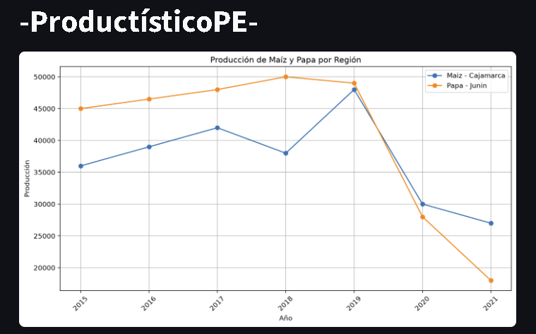
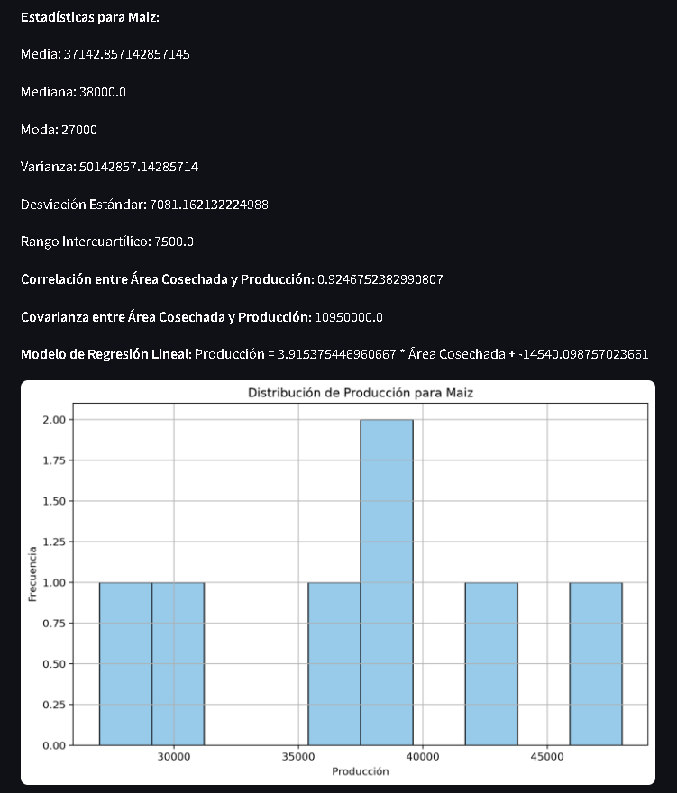
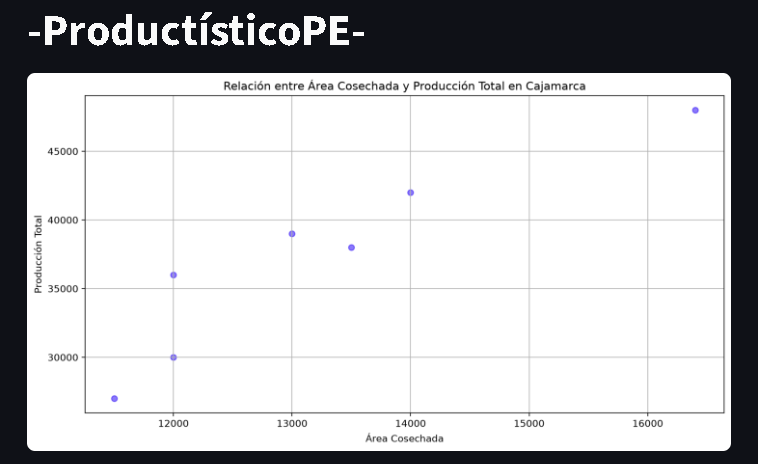

# ProductísticoPE — Análisis de producción agrícola en Perú

**ProductísticoPE** es una aplicación web académica desarrollada en equipo con **Python y Streamlit** para explorar archivos agrícolas CSV/Excel, consultar indicadores descriptivos y visualizar relaciones entre producción, cultivos, regiones y años.

> **Alcance de los datos:** `Tabla1.csv` y `Tabla2.xlsx` son los archivos utilizados en el trabajo académico. Su origen, unidades y correspondencia con estadísticas oficiales del INEI **no se han verificado**. No deben citarse como series oficiales. La regresión lineal implementada es **exploratoria**, no un pronóstico validado.

## Funcionalidades implementadas

| Módulo | Función |
| --- | --- |
| Ver datos CSV y Excel | Consultar las tablas desde la interfaz |
| Gráfico de producción | Comparar tendencias de maíz y papa entre dos años seleccionados |
| Exportaciones y consumo | Comparar producción y exportaciones de arroz en dos regiones |
| Gráfico de dispersión | Explorar la relación entre área cosechada y producción por región |
| Gráfico pastel | Mostrar la proporción de producción de una región frente a las demás |
| Estadísticas | Calcular media, mediana, moda, varianza, desviación estándar, rango intercuartílico, correlación de Pearson y covarianza; ajustar una regresión lineal simple |
| Exportar datos | Descargar el CSV de producción o el Excel de exportaciones desde el navegador |

## Capturas de la aplicación

### Producción por región y año


### Estadísticas descriptivas


### Área cosechada y producción


### Descarga de información


## Tecnologías

- **Python**: lógica de la aplicación, implementada en la clase `AgriculturaData`.
- **Streamlit**: interfaz y controles interactivos.
- **pandas**: lectura y procesamiento de CSV/Excel.
- **Matplotlib**: gráficos estadísticos.
- **scikit-learn**: regresión lineal simple (`LinearRegression`).
- **openpyxl**: lectura y exportación de Excel.

## Instalación y ejecución

Requisitos: **Python 3.10 o superior**, Git opcional para clonar. En Windows, desde la raíz del repositorio:

```powershell
py -m venv .venv
.\.venv\Scripts\python.exe -m pip install -r requirements.txt
.\.venv\Scripts\python.exe -m streamlit run app.py
```

Abre la URL indicada por Streamlit (normalmente `http://localhost:8501`). La aplicación utiliza `Tabla1.csv` y `Tabla2.xlsx` ubicados junto a `app.py`. No requiere una base de datos ni credenciales externas.

## Estructura

```text
productistico-pe-analytics/
├── app.py
├── Tabla1.csv
├── Tabla2.xlsx
├── requirements.txt
├── .gitignore
├── capturas/
│   ├── 01-produccion.png
│   ├── 02-estadisticas.png
│   ├── 03-dispersion.png
│   └── 04-exportacion.png
└── README.md
```

## Limitaciones y mejoras futuras

- Verificar el origen de los datos, unidades, períodos y metodología.
- Añadir evaluación de regresión con partición entrenamiento/prueba y métricas como MAE, RMSE y R² antes de afirmar capacidad predictiva.
- Validar valores faltantes y facilitar la selección de cultivos y períodos.
- El análisis se limita a los datos incluidos; no hay actualización automática ni conexión al INEI.

## Autoría

Proyecto grupal del curso **Programación Orientada a Objetos**, Universidad Peruana de Ciencias Aplicadas (UPC). Integrantes: **Diego Joaquín Díaz Urday, Diego Alberto Aquino Chaccara y Manuel Jesús Chávez Cuba**.
